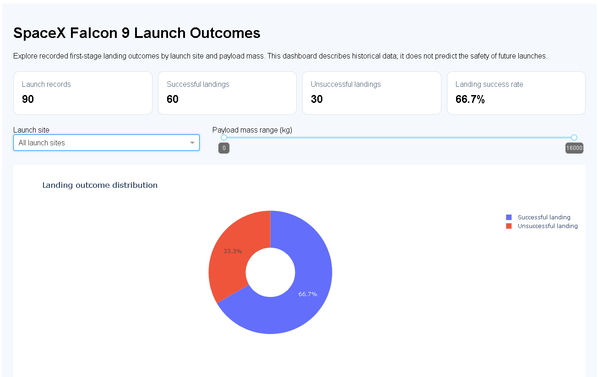
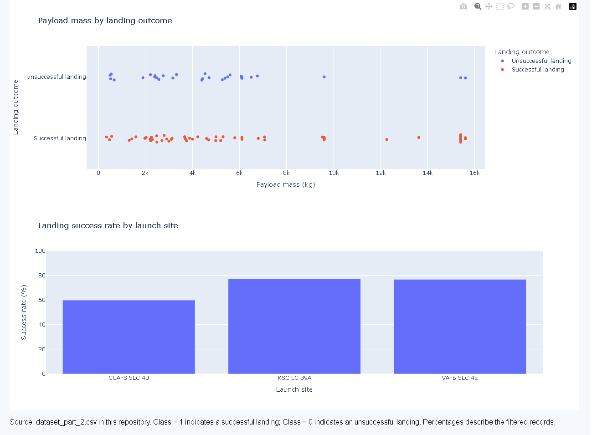

# SpaceX Falcon 9 Launch Analysis

An end-to-end data analysis project exploring historical SpaceX Falcon 9 launches and the factors associated with first-stage landing success. The project brings together data collection, data cleaning, exploratory analysis, SQL, geospatial visualisation, an interactive dashboard, and introductory machine learning.

**Portfolio objective:** Demonstrate how raw operational data can be prepared, analysed, visualised, and communicated to support evidence-based decisions.

## Business question

First-stage booster recovery is central to rocket reusability. This project explores whether historical launch characteristics—including launch site, payload mass, orbit, flight number, and booster configuration—are associated with landing outcomes.

The guiding question is:

> What patterns in historical launches could help explain and estimate first-stage landing outcomes?

This is an exploratory portfolio project, not an operational launch-safety system or a validated cost-pricing model.

## Project workflow and tools

| Stage | Work | Tools |
|---|---|---|
| Data collection | Retrieve launch information from the SpaceX API | Python, Requests, pandas |
| Web scraping | Extract launch records from a web table | Python, BeautifulSoup, pandas |
| Data preparation | Clean, transform, and prepare modelling data | pandas |
| Exploratory analysis | Investigate outcomes, payloads, launch sites, orbits, and trends | pandas, Matplotlib, Seaborn |
| SQL analysis | Query launch data to answer analytical questions | SQL, SQLite, Jupyter |
| Geospatial analysis | Map launch locations and explore site geography | Folium |
| Interactive dashboard | Explore launch records by site and payload range | Plotly, Dash |
| Predictive modelling | Compare classification models for landing outcomes | scikit-learn |
| Communication | Present findings, methods, and limitations | Jupyter, PowerPoint, PDF |

## Key exploratory findings

The notebooks explore several patterns in the historical dataset:

- **Launch site:** Reported landing-success rates vary across launch sites.
- **Orbit:** Outcomes differ by orbit category. Categories with few observations require particular caution.
- **Time trends:** The analysis reports an upward trend in landing success over the period covered by the dataset.
- **Payload and flight number:** Visualisations explore how these variables relate to landing outcomes.

These are descriptive patterns, not evidence of causation. Results depend on the dataset and the period analysed.

## Machine-learning evaluation

Four classification models were compared to explore whether historical launch characteristics could help classify first-stage landing outcomes.

| Model | Test accuracy | Precision | Recall | F1-score |
|---|---:|---:|---:|---:|
| Logistic Regression | 77.8% | 78.6% | 91.7% | 84.6% |
| Support Vector Machine | 77.8% | 78.6% | 91.7% | 84.6% |
| Decision Tree | 77.8% | 83.3% | 83.3% | 83.3% |
| K-Nearest Neighbours | 77.8% | 75.0% | 100.0% | 85.7% |

The Decision Tree achieved the highest reported mean cross-validation accuracy, approximately **90.4%**. All four models achieved the same accuracy on the held-out test set.

**Interpretation:** K-Nearest Neighbours had the highest reported recall and F1-score, while the Decision Tree had the highest precision. Which metric matters most depends on the cost of different types of classification error.

**Important caveat:** The held-out test set contains only 18 launches, so each prediction has a substantial effect on the reported metrics. The cross-validation result is a useful comparison within this dataset, but it does not demonstrate that the model will generalise to new launches. These models are exploratory and should not be used for operational launch decisions.

The figures above are the results currently documented for this project. Re-run the machine-learning notebook from top to bottom before quoting these metrics in an application or interview, and ensure the saved outputs match the current code and data.

## Interactive dashboard

**[Open the live SpaceX launch dashboard](https://applied-data-capstone.onrender.com)**

The dashboard is built with Python, Dash, and Plotly. It allows visitors to explore launch data through interactive visualisations and filters.

- Filter launches by launch site.
- Explore payload mass ranges.
- Examine launch and landing outcomes.
- Compare success rates across launch sites.

The dashboard is hosted on Render. If the service has been idle, the first visit may take a little time to load.

### Dashboard preview





## Repository guide

### Analysis notebooks

- [Data collection using the SpaceX API](Data%20Collection%20API.ipynb)
- [Data collection with web scraping](Data%20Collection%20with%20Web%20Scraping.ipynb)
- [Data wrangling](Data%20Wrangling.ipynb)
- [Exploratory analysis and visualisation](EDA%20with%20Data%20Visualization.ipynb)
- [SQL analysis notebook](EDA%20with%20SQL.ipynb)
- [Interactive mapping with Folium](Interactive%20Visual%20Analytics%20with%20Folium.ipynb)
- [Machine-learning model comparison](Machine%20Learning%20Prediction.ipynb)

### Data, SQL, and reporting

- [Prepared launch dataset](dataset_part_2.csv)
- [Model features dataset](dataset_part_3.csv)
- [Web-scraped launch records](spacex_web_scraped.csv)
- [Standalone SQLite analysis queries](sql/analysis_queries.sql)
- [Final presentation](Apllied%20Data%20Science%20Capstone%20Final%20Presentation.pptx)
- [Project report](Winning%20Space%20Race%20with%20Data%20Science.pdf)

### Application and dependencies

- [Dashboard source code](app.py)
- [Dashboard dependencies](requirements.txt)
- [Notebook dependencies](requirements-notebooks.txt)

## Run the dashboard locally

Use Python 3.10 or newer if possible.

1. Clone this repository and open the project directory.
2. Install the dashboard dependencies:

   ```bash
   pip install -r requirements.txt
   ```

3. Start the dashboard:

   ```bash
   python app.py
   ```

4. Open the local address printed in your terminal.

The dashboard reads the committed `dataset_part_2.csv` dataset. Notebook dependencies are listed separately because individual notebooks may require additional packages or setup. Some original course notebooks may contain cloud-service setup cells that need adapting for local use.

## Run the standalone SQL queries

The queries in [`sql/analysis_queries.sql`](sql/analysis_queries.sql) use SQLite syntax. Import `dataset_part_2.csv` into a local SQLite database as a table named `launches`, preserving the column headers, then run the queries.

The queries cover launch-site and orbit success rates, yearly trends, payload comparisons, booster flight counts, and basic data-quality checks.

## Skills demonstrated

- **Python:** data collection, cleaning, transformation, and analysis
- **SQL:** filtering, aggregation, grouping, and analytical queries
- **Visualisation:** Matplotlib, Seaborn, and Plotly
- **Dashboarding:** interactive applications with Plotly Dash
- **Geospatial analysis:** mapping with Folium
- **Machine learning:** classification, cross-validation, and model evaluation with scikit-learn
- **Communication:** documenting methods, interpreting results, and explaining limitations

## Limitations and future improvements

- The modelling dataset is small, and the documented test set contains only 18 records.
- Historical associations do not establish causation and should not be used alone for operational decisions.
- Model evaluation should consider class balance, confusion-matrix counts, precision, recall, and F1-score—not accuracy alone.
- Reproducibility can be strengthened by documenting data provenance, dependency versions, and consistent notebook paths.
- The dashboard should be tested periodically against the committed dataset and deployment environment.

## Project context

This project follows the learning workflow of the IBM Data Science Professional Certificate Applied Data Science Capstone. The repository includes course-based instructional material alongside project code, analysis, and reporting. The README summarises the project for portfolio review; future improvements should prioritise reproducibility, independent interpretation, and clearly evidenced analytical insights.
